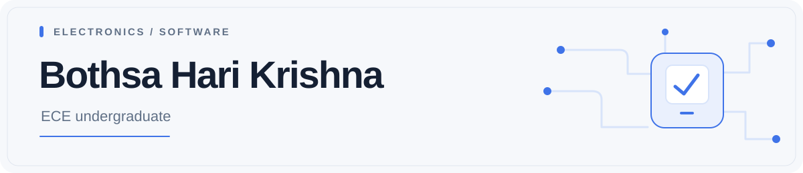

<picture>
  <source media="(prefers-color-scheme: dark)" srcset="./assets/profile-dark.svg">
  <source media="(prefers-color-scheme: light)" srcset="./assets/profile-light.svg">
  
</picture>

### Hi, I'm Hari.

I'm an **Electronics and Communication Engineering undergraduate** interested in how hardware and software come together. I enjoy building practical ideas, learning from mistakes, and making things easier to use.

**Learning:** `Kotlin` · `Jetpack Compose` · `Python` · `IoT`

**Exploring:** Android apps · Sensors · UI design · AI-assisted development

**My focus:** Build small, reliable projects I can understand and explain.

**Open to internships and hands-on engineering opportunities.**
